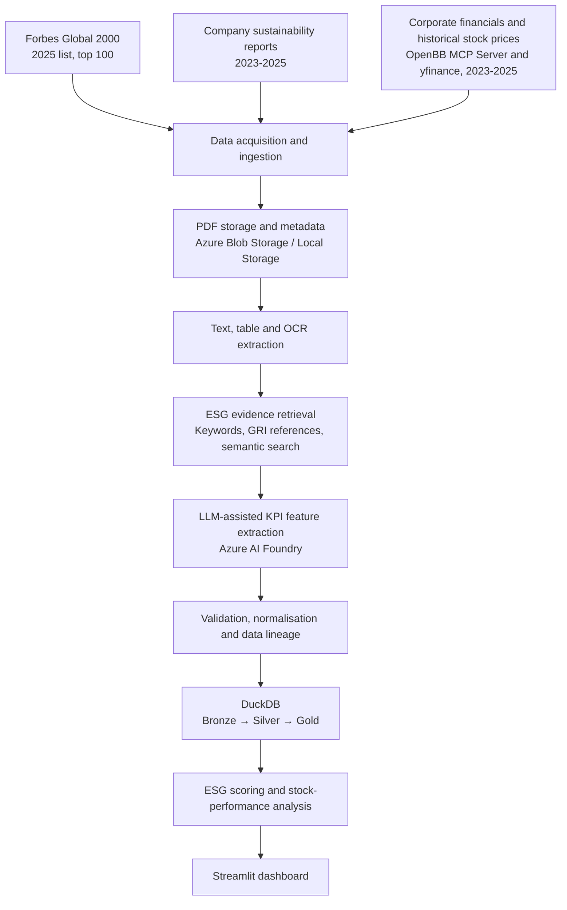
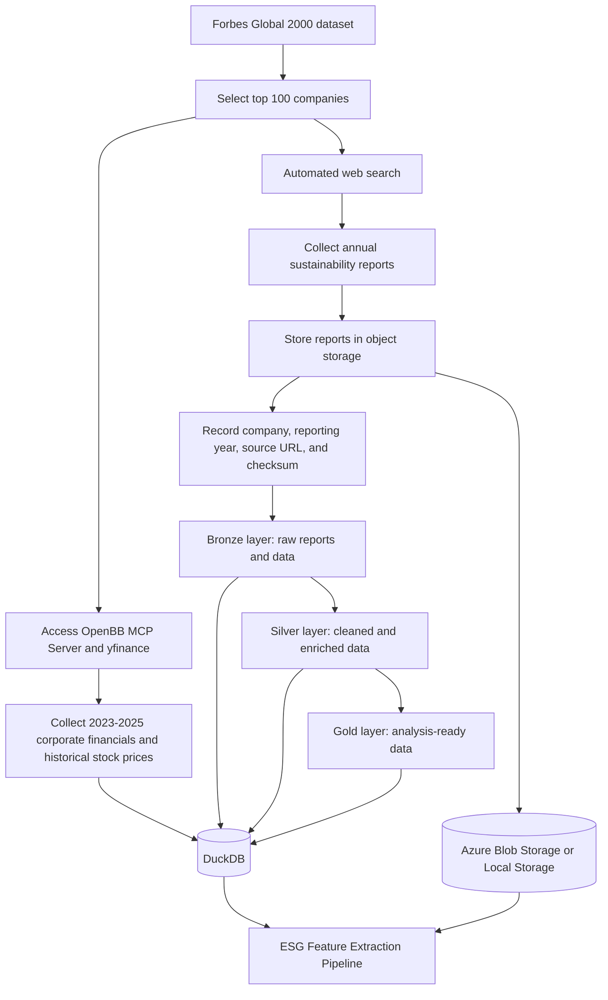
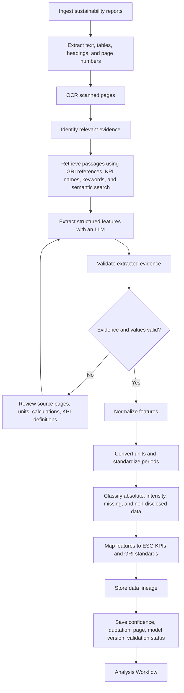
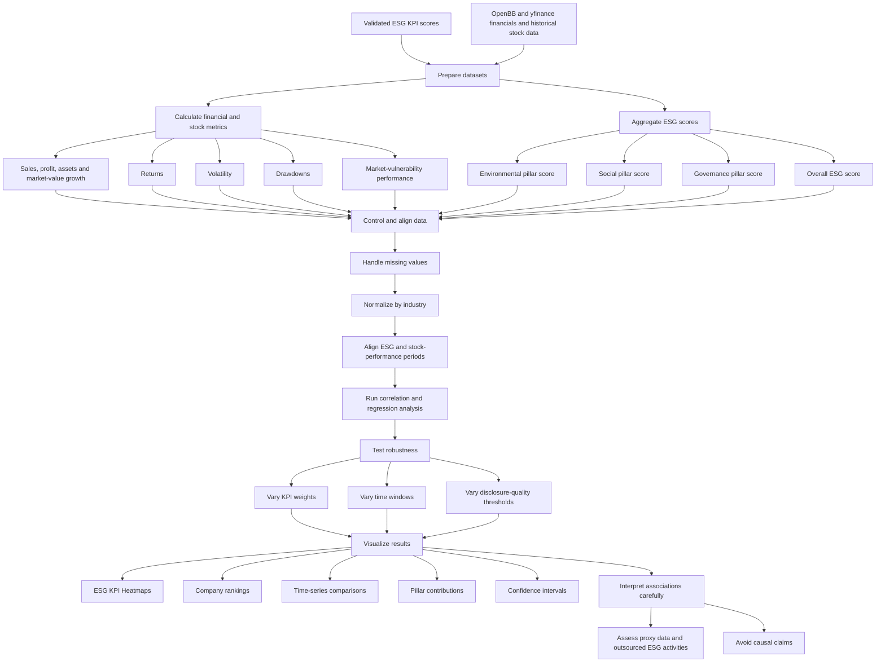

## Overview
- [High-Level Architecture](#high-level-architecture)
- [Data Ingestion Pipeline](#data-ingestion-pipeline)
- [ESG Feature Extraction Pipeline](#esg-feature-extraction-pipeline)
- [Analysis Workflow](#analysis-workflow)
- [Recommended Project Structure](#recommended-project-structure)
- [Project Structure guidelines](#project-structure-guidelines)

<br/>
<hr>

## High-Level Architecture



## Data Ingestion Pipeline


- [Back to top](#overview)

## ESG Feature Extraction Pipeline



## Analysis Workflow


- [Back to top](#overview)

<hr>

### Recommended Project Structure

The repository should separate the executable Python package from documentation, configuration, tests, and data products. Within the package, dependencies should flow from domain models and interfaces toward infrastructure adapters and user-facing entry points. This keeps the analysis reproducible and makes it possible to replace yfinance, local file storage, or Azure services without rewriting the scoring and analysis logic.

```text
esg-profile/
├── README.md
├── .gitignore
│
├── docs/
│   ├── ARCHITECTURE.md
│   ├── KPI_Breakdown.md
│   ├── DESIGN_DECISIONS.md
│   └── DESIGN_PATTERNS.md
│
├── esg-profile/                       # Python package project
│   ├── pyproject.toml
│   ├── uv.lock
│   ├── .python-version
│   ├── src/
│   │   └── esg_profile/
│   │       ├── __init__.py
│   │       ├── cli.py                  # CLI commands and pipeline orchestration
│   │       ├── config.py               # Environment and typed settings
│   │       │
│   │       ├── domain/                 # Framework-independent business rules
│   │       │   ├── models/             # Company, report, KPI, score, and metric models
│   │       │   ├── enums.py
│   │       │   └── scoring.py           # KPI, pillar, and overall ESG scoring
│   │       │
│   │       ├── ports/                  # Interfaces for replaceable dependencies
│   │       │   ├── market_data.py       # Financials and historical prices
│   │       │   ├── report_sources.py    # Report discovery and retrieval
│   │       │   ├── object_storage.py
│   │       │   └── warehouse.py
│   │       │
│   │       ├── adapters/               # External systems implementing ports
│   │       │   ├── openbb/
│   │       │   ├── yfinance/
│   │       │   ├── azure_blob/
│   │       │   ├── local_storage/
│   │       │   └── duckdb/
│   │       │
│   │       ├── pipelines/
│   │       │   ├── acquisition/        # Forbes, reports, financials, and prices
│   │       │   ├── documents/          # PDF parsing, tables, OCR, and evidence retrieval
│   │       │   ├── extraction/         # LLM extraction, validation, and lineage
│   │       │   ├── normalization/      # Units, periods, currencies, and identifiers
│   │       │   └── scoring/             # ESG scores and disclosure-quality measures
│   │       │
│   │       ├── analysis/
│   │       │   ├── metrics.py           # Returns, volatility, drawdowns, and growth
│   │       │   ├── dataset.py           # Period and industry alignment
│   │       │   ├── statistics.py        # Correlation, regression, and robustness tests
│   │       │   └── vulnerability.py    # Market-vulnerability event definitions
│   │       │
│   │       └── dashboard/
│   │           ├── app.py               # Streamlit entry point
│   │           ├── queries.py           # Gold-layer dashboard queries
│   │           └── components/          # Charts, tables, and evidence views
│   │
│   ├── sql/
│   │   ├── bronze/                     # Raw-ingestion table definitions
│   │   ├── silver/                     # Cleaned and validated transformations
│   │   └── gold/                       # Analysis-ready views and aggregates
│   └── tests/
│       ├── unit/
│       ├── integration/
│       └── fixtures/
│
├── data/                               # Local runtime data; do not commit
│   ├── raw/                            # Downloaded PDFs and source responses
│   ├── bronze/
│   ├── silver/
│   ├── gold/
│   └── warehouse.duckdb
│
├── configs/
│   ├── default.toml
│   ├── kpi_mapping.toml
│   └── companies.csv
├── scripts/                            # Reproducible operational and exploratory entry points
└── artifacts/                          # Reports, plots, and run manifests; do not commit
```

### Project Structure guidelines

- Keep `domain/` independent of Streamlit, DuckDB, Azure SDKs, and provider-specific response formats.
- Keep source-specific code behind `ports/` and `adapters/`; OpenBB and yfinance should implement the same market-data interface.
- Treat `data/raw/` and Bronze records as immutable inputs. Rebuild Silver and Gold outputs from them instead of editing derived data manually.
- Store extraction evidence and lineage with the Silver KPI records, including source checksum, page, quotation, confidence, model version, and validation status.
- Put reusable production logic in `src/`. Exploration and demonstrations are scripted too, through the CLI or `scripts/`; the project uses no notebooks.
- Keep secrets in environment variables or a local secret manager. Commit configuration templates, not credentials.
- Add tests at the same boundaries as the tree: unit-test scoring and normalization, integration-test adapters and DuckDB transformations, and use fixtures for small representative PDFs and API responses.

- [Back to top](#overview)