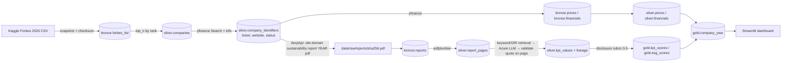

# Pilot Plan: end-to-end ESG pipeline for the top 3 Forbes 2026 companies (FY2023-2025)

The work plan for the pilot. The decisions behind it are in [DESIGN_DECISIONS.md](DESIGN_DECISIONS.md) (mainly [DD-012][dd012] to [DD-016][dd016]); each implementation step is tracked as a GitHub issue (see [Issues](#issues)).

- [Context](#context)
- [Pipeline](#pipeline)
- [Key design points](#key-design-points)
- [Dependencies](#dependencies)
- [Issues](#issues)
- [Verification](#verification)

## Context
The repo has a detailed design ([RESEARCH.md](RESEARCH.md), [ARCHITECTURE.md](ARCHITECTURE.md), [DD-001][dd001] to [DD-011][dd011]). Before scaling to 100 companies, we build a **thin, fully dynamic slice** that runs every pipeline stage once on real data: Forbes list → tickers → financials and prices → reports → extraction → scoring → Gold → Streamlit ([DD-012][dd012]). **No company names or tickers in code or config.** Only `top_n = 3` and the year window are configurable.

Agreed decisions:
- **Companies:** the top 3 of the **Forbes Global 2000 2026** list; the full study also uses the 2026 list ([DD-012][dd012]).
- **Data window:** **FY2023-FY2025**, the same years for reports, financials and stock prices ([DD-008][dd008]). FY2026 reports don't exist yet.
- **Forbes source:** the Kaggle dataset, downloaded with `kagglehub` ([DD-013][dd013]).
- **Report search:** **SerpApi** free plan ([DD-014][dd014]).
- **Market data:** **yfinance**, for financials and daily prices, behind a provider adapter ([DD-009][dd009]).
- **Extraction:** small LLM extraction on **Azure AI Foundry** (free student tier) ([DD-010][dd010], [DD-016][dd016]).
- **What the pilot proves:** that the pipeline works. With 3 companies × 3 years, the dashboard shows data, not correlation results.

## Pipeline

## Key design points
- **Config (no hard-coding, [DD-012][dd012]):** `configs/default.toml` holds `top_n`, `fiscal_years = [2023, 2024, 2025]`, the KPI subset, the LLM deployment name, prompt version and paths. Secrets (`KAGGLE_*`, `SERPAPI_API_KEY`, `AZURE_OPENAI_*`) go in `.env`, read with `pydantic-settings`. A committed `.env.example` lists them without values.
- **Ports and adapters ([DD-011][dd011], kept proportional):**
  - Ports are `typing.Protocol` interfaces: `CompanyListSource`, `MarketData`, `ReportSearch`, `Extractor`.
  - Adapters: `kaggle/`, `yfinance/`, `serpapi/`, `azure_llm/`, `duckdb/`.
  - Only the folders the pilot needs are created.
- **Storage ([DD-001][dd001], [DD-002][dd002], [DD-003][dd003]):** DuckDB with Bronze, Silver and Gold schemas; PDFs on local disk named by SHA-256, with the checksum recorded in DuckDB.
- **Ticker resolution, which fails loudly ([DD-015][dd015]):**
  - Run `yf.Search(forbes_name)` and keep only `EQUITY` quotes.
  - Prefer a listing on the exchange of the Forbes company's home country.
  - If exactly one candidate passes, mark it `resolved`. Otherwise store all candidates with status `needs_review` and stop that company.
  - Website comes from `Ticker.info["website"]`.
- **Report discovery ([DD-014][dd014]):**
  - SerpApi query: `"{name}" sustainability report {FY} filetype:pdf`, first restricted to `site:{domain}`, then a fallback without the site restriction.
  - Validation: the file starts with `%PDF`, and its first pages mention the company name and the year. The SHA-256 of the file becomes its filename and key.
  - Every query and response is cached in Bronze, so reruns cost no quota.
- **Financials ([DD-008][dd008], [DD-009][dd009]):**
  - From yfinance: revenue (sales), net income (profit) and total assets, per fiscal year.
  - Market value = closing price at fiscal year end × shares outstanding.
  - Each company's fiscal-year-end month is stored so ESG and financial periods line up.
  - **Risk:** yfinance usually returns only the last ~4 annual statements. As of 2026-11 that should still include FY2023, but it's at the edge. Missing years are recorded as missing, never filled in, and if FY2023 is missing the run logs a loud warning. If yfinance runs short, the fallback is the OpenBB adapter ([DD-009][dd009]), as a follow-up issue.
- **Extraction ([DD-004][dd004], [DD-010][dd010], [DD-016][dd016]):**
  - Parse text locally with `pdfplumber`. **No OCR** in the pilot: pages with no text are flagged and skipped.
  - For each KPI, pick the top-k pages by keyword and GRI code. Send them to the Azure LLM through LangChain's `AzureChatOpenAI` with structured (Pydantic) output.
  - Validation: the quote the LLM returns must appear on the cited page. Otherwise status is `unvalidated`.
  - Lineage stored per value: checksum, page, quote, confidence, model, prompt version, status.
  - Results are cached by (checksum, KPI, prompt version).
- **Pilot KPIs (9, [DD-016][dd016]):**
  - E: CO₂ emissions (GRI 305), energy consumption (302), renewable energy % (302).
  - S: workforce diversity (405), turnover (401), training hours (404).
  - G: board diversity (405-1), anti-corruption (205), executive pay linked to ESG (2-19).
- **Scoring ([DD-005][dd005], [DD-016][dd016]):**
  - Use the existing 0-5 rubric in [RESEARCH.md](RESEARCH.md#esg-score-based-on-gri-based-esg-kpis).
  - Pillar score = equal-weight mean of its KPI scores; overall score = mean of the three pillars.
  - Disclosure quality and performance are kept in separate columns.
  - **Open:** rubric level 5 includes "positive performance", which conflicts with [DD-005][dd005]. Resolve before issue 7 (see [Open Decisions](RESEARCH.md#open-decisions)).
- **Idempotency ([DD-001][dd001]):**
  - Every table has natural keys, e.g. `(ticker, date)` and `(checksum, kpi_id, prompt_version)`. Writes are upserts.
  - All timestamps are UTC, with `run_id` and `ingested_at`.
  - Bronze is append-only. Silver and Gold are rebuilt from it.
- **CLI:** `esg-profile run <stage>` and `esg-profile run all`. Stages: `forbes`, `identifiers`, `market`, `reports`, `extract`, `score`, `gold`. The dashboard ([DD-007][dd007]) runs with `streamlit run …/dashboard/app.py`.
- **Scripted only ([DD-011][dd011]):** no notebooks; exploration goes through the CLI or `scripts/`.

## Dependencies
- **Runtime:** `duckdb`, `yfinance`, `kagglehub`, `httpx`, `pdfplumber`, `langchain-openai`, `pydantic`, `pydantic-settings`, `streamlit`, `plotly`, `pandas`.
- **Dev:** `pytest`, `ruff`, `mypy`.
- SerpApi is called directly with `httpx` against its documented REST endpoint, so it needs no SDK.

## Issues
One branch and PR per issue. Each issue starts with failing tests (TDD) and updates [DESIGN_DECISIONS.md](DESIGN_DECISIONS.md) and [DESIGN_PATTERNS.md](DESIGN_PATTERNS.md) in the same change.

| # | Issue | Main decisions |
|---|---|---|
| 0 | ISSUE0 Foundations: `.gitignore`, `.gitattributes`, dependencies, pytest/ruff/mypy, config, DuckDB setup, CLI skeleton | [DD-001][dd001], [DD-002][dd002], [DD-011][dd011], [DD-012][dd012] |
| 1 | ISSUE1 Forbes ingest: Kaggle adapter → `bronze.forbes_list` → `silver.companies` (top N) | [DD-012][dd012], [DD-013][dd013] |
| 2 | ISSUE2 Identifier resolution: tickers and websites, with the `needs_review` path | [DD-015][dd015] |
| 3 | ISSUE3 Market data: yfinance adapter → prices and financials, Bronze → Silver | [DD-008][dd008], [DD-009][dd009] |
| 4 | ISSUE4 Report discovery: SerpApi adapter, PDF download and validation → `bronze.reports` | [DD-003][dd003], [DD-014][dd014] |
| 5 | ISSUE5 Parse and retrieve: `silver.report_pages` and evidence selection per KPI | [DD-010][dd010], [DD-016][dd016] |
| 6 | ISSUE6 LLM extraction and validation: `silver.kpi_values` with lineage | [DD-004][dd004], [DD-010][dd010], [DD-016][dd016] |
| 7 | ISSUE7 Scoring: `gold.kpi_scores`, `gold.esg_scores` | [DD-005][dd005], [DD-016][dd016] |
| 8 | ISSUE8 Gold and dashboard: `gold.company_year` and the Streamlit page | [DD-007][dd007], [DD-008][dd008] |

## Verification
- `uv run pytest`: unit tests for ticker selection, the scoring rubric, quote validation, return/volatility/drawdown math, and fiscal-year alignment. Integration tests use in-memory DuckDB and recorded fixtures (yfinance and SerpApi JSON, a 2-page PDF). Tests never call the network.
- `uv run ruff check` and `uv run mypy src`.
- An end-to-end `uv run esg-profile run all` with real keys. Then check with read-only `LIMIT` queries:
  - 3 companies resolved
  - prices for 2023-01-01 to 2025-12-31
  - financials for FY2023-2025, with any gaps logged
  - up to 9 reports (3 companies × 3 years)
  - 9 KPIs × company-year in `gold.kpi_scores`
- Run the same command again: row counts must not change, and no new SerpApi or LLM calls should be made (cache hits are logged).
- `uv run streamlit run src/esg_profile/dashboard/app.py`, then check the page manually.
- Before the real run: confirm the Azure quota and model deployment (an open item in [RESEARCH.md](RESEARCH.md#open-decisions)), and estimate the LLM cost (expected €0 on the student credit).

[dd001]: DESIGN_DECISIONS.md#dd-001-medallion-bronzesilvergold-architecture-for-storage
[dd002]: DESIGN_DECISIONS.md#dd-002-duckdb-as-the-analytical-database
[dd003]: DESIGN_DECISIONS.md#dd-003-object-storage-azure-blob--local-separate-from-the-relational-database
[dd004]: DESIGN_DECISIONS.md#dd-004-llm-assisted-extraction-with-a-validation-loop-not-direct-parsing
[dd005]: DESIGN_DECISIONS.md#dd-005-separate-disclosure-quality-from-performance-in-the-data-model
[dd007]: DESIGN_DECISIONS.md#dd-007-streamlit-for-the-dashboard
[dd008]: DESIGN_DECISIONS.md#dd-008-corporate-financial-performance-as-the-primary-dataset-2023-2025
[dd009]: DESIGN_DECISIONS.md#dd-009-openbb-mcp-server-and-yfinance-behind-a-provider-adapter
[dd010]: DESIGN_DECISIONS.md#dd-010-free-tier-llm-and-ocr-extraction-on-an-azure-ai-foundry-student-account
[dd011]: DESIGN_DECISIONS.md#dd-011-layered-python-package-with-ports-and-adapters
[dd012]: DESIGN_DECISIONS.md#dd-012-dynamic-pilot-on-the-forbes-2026-list-with-the-full-study-moving-to-2026
[dd013]: DESIGN_DECISIONS.md#dd-013-forbes-2026-list-from-kaggle-downloaded-with-kagglehub
[dd014]: DESIGN_DECISIONS.md#dd-014-serpapi-for-sustainability-report-discovery
[dd015]: DESIGN_DECISIONS.md#dd-015-runtime-ticker-and-website-resolution-with-a-human-review-stop
[dd016]: DESIGN_DECISIONS.md#dd-016-pilot-extraction-text-layer-only-keyword-and-gri-retrieval-nine-kpis
